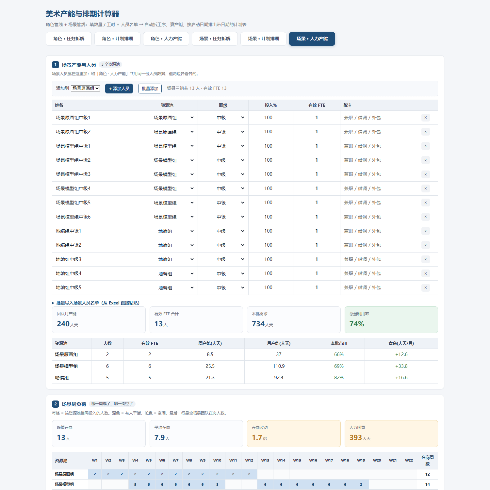
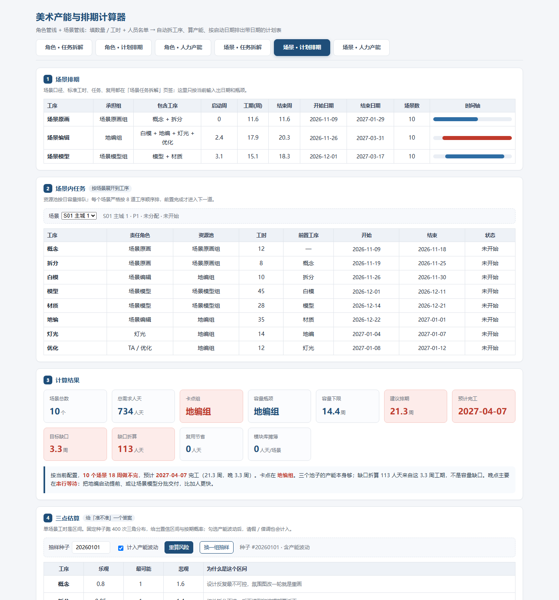
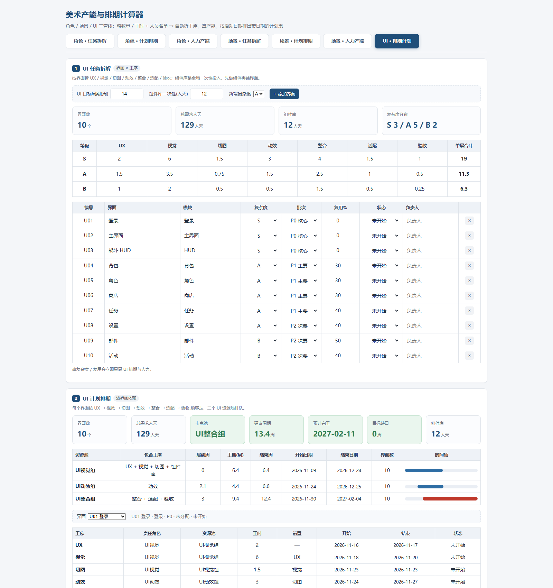
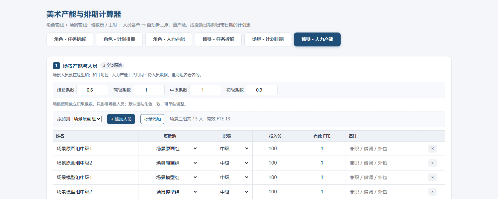

# 美术产能与排期计算器

面向游戏美术项目管理的单文件工具：把「数量 / 工时 + 人员名单」拆成工序、算产能、按启动日期排出带日期的计划，并给出风险、缺口方案和资产台账。

- 纯前端单文件，无后端、无构建、无依赖
- 数据保存在浏览器 `localStorage`，可导出 CSV
- 支持角色、场景、UI 三条管线

## 在线访问

https://stevenqii.github.io/art-capacity-calculator/

## 功能

### 角色 · 任务拆解 / 计划排期 / 人力产能
- 原画 / 模型 / 绑定 / 动作 / 特效 / 整合六道工序
- 模型组、绑定组独立资源池
- 三点估算、Monte Carlo 工期风险
- 缺口三解：加人 / 外包 / 砍范围 / 延期
- 方案对比、资产台账

### 场景 · 任务拆解 / 计划排期 / 人力产能
- 概念 / 拆分 / 白模 / 模型 / 材质 / 地编 / 灯光 / 优化八道工序
- 场景原画 / 场景模型 / 场景编辑三个资源池
- 逐场景依赖排期：每个场景按工序顺序走，资源池排队，给出真实开始/结束日期
- 场景 WBS：面积系数、组件复用、模块库、批次、门禁
- 场景缺口三解、三点估算、方案对比、资产台账

### UI · 排期计划
- UX / 视觉 / 切图 / 动效 / 整合 / 适配 / 验收七道工序
- UI视觉 / UI动效 / UI整合三个资源池
- 按界面逐条排期，组件库单独按一次性投入
- UI 人员批量添加、名单导入、独立职级系数、团队产能

## 作为 DSH Skill 使用

仓库里的 `skills/art-capacity-calculator/` 是 DeepSeek Harness 的 skill 版本：

```text
skills/art-capacity-calculator/
├── SKILL.md
├── assets/art-capacity-calculator.html
└── references/
    ├── methodology.md
    ├── audit-checklist.md
    └── examples.md
```

安装到用户级 DSH skill 目录：

**Windows PowerShell**

```powershell
New-Item -ItemType Directory -Force "$env:USERPROFILE\.dsh\skills" | Out-Null
Copy-Item ".\skills\art-capacity-calculator" "$env:USERPROFILE\.dsh\skills\" -Recurse -Force
```

**macOS / Linux**

```bash
mkdir -p ~/.dsh/skills
cp -R skills/art-capacity-calculator ~/.dsh/skills/
```

重开一个 DSH 会话后，skill 目录中会出现 `art-capacity-calculator`。它包含：

- 角色 / 场景 / UI 三条管线的 WBS 与排期方法
- 产能、缺口、三点估算、缺口三解公式
- 专业校验清单
- 可直接打开的交互版 HTML 工具

## 使用

1. 下载 `index.html`
2. 双击用 Chrome / Edge 打开
3. 在「角色 · 人力产能」「场景 · 人力产能」「UI · 排期计划」里维护人员
4. 在任务拆解页填数量/工时，计划排期页自动出日期
5. 需要给同事/开会时，点底部「导出表格（Excel 可打开）」

数据只存在当前浏览器；换电脑或清缓存前请先导出 CSV。

## 截图

### 角色 · 人力产能


### 场景 · 计划排期


### UI · 排期计划


### 场景独立职级系数


## 部署到 GitHub Pages

仓库设置 → Pages → Build and deployment：

- Source: `Deploy from a branch`
- Branch: `main`
- Folder: `/ (root)`

保存后访问：

```text
https://<your-github-username>.github.io/art-capacity-calculator/
```

## 目录

```text
.
├── index.html
├── README.md
└── screenshots/
    ├── coef.png
    ├── people.png
    ├── scene.png
    └── ui.png
```

## 说明

- 单文件版本便于内网/本地直接打开，不依赖服务器
- 浏览器建议 Chrome / Edge 最新版
- 所有计算在本地完成，不上传任何人员或项目数据
